# WHE-242: the models' range on the spot page, explained

## Round 2 (20 Nov): arrows instead of "ENE–SE"

You found the "ENE–SE" text unreadable on the phone. Now, on hours where the models are 45° or more apart, the single arrow becomes **one small arrow per model**, each pointing the way its wind blows, side by side. A model whose wind is **offshore for that beach is red** (same rule the scoring uses). Hours where the models agree keep the single arrow, and the words after it are back to the usual "NW side-onshore". The arrow slot has the same width on every row, so the words stay lined up.

| Case | Before (text) | After (arrows) |
|---|---|---|
| 2 models, one offshore (Le Barcarès – Dosses, 25 Nov, 13:00) | 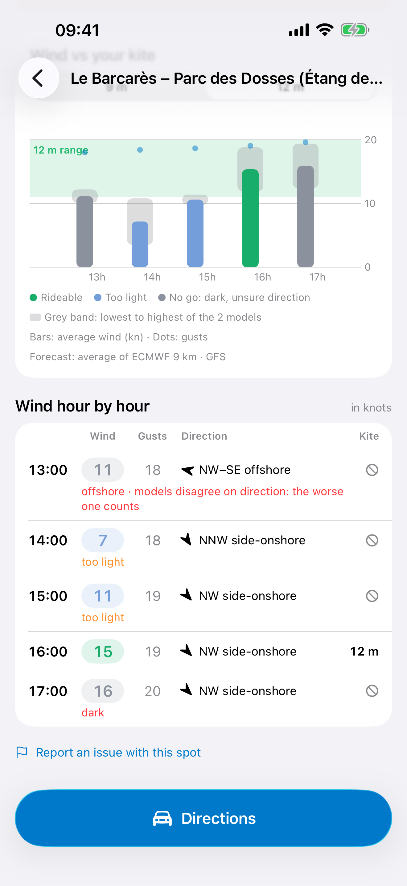 | 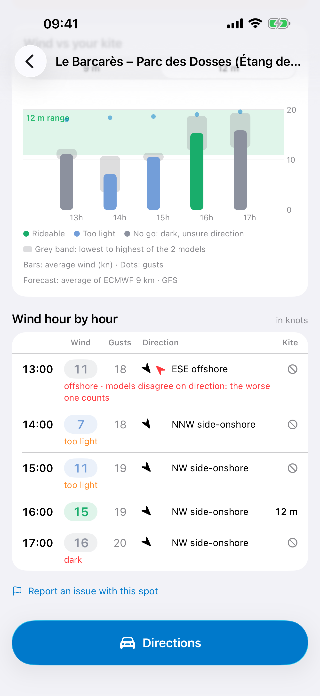 |
| 2 models, neither offshore (El Trabucador, 25 Nov) |  | 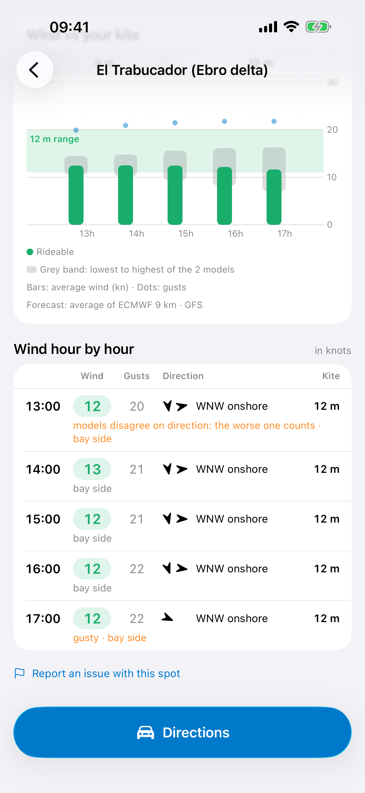 |
| 3 models (Malgrat de Mar, 22 Nov: ARPEGE, ECMWF, GFS) | (not shot) | 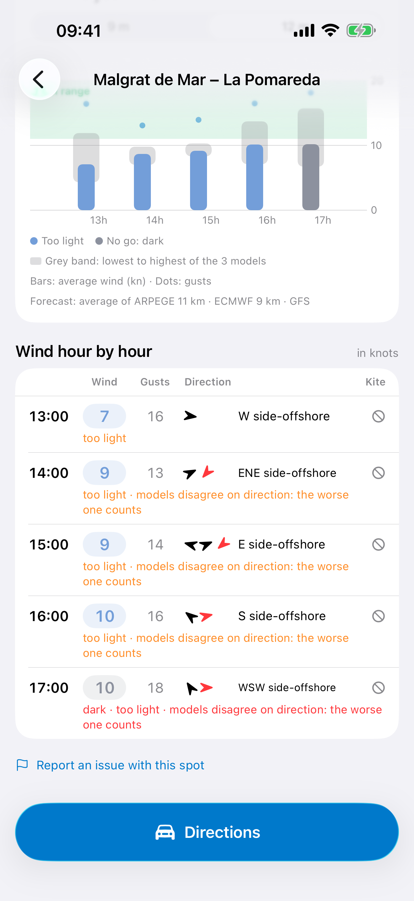 |

Notes:
- A model under 8 kn has no meaningful direction and gets no arrow (e.g. Malgrat 16:00 shows 2 of 3).
- **Map fan kept**: it stays clean (one light wedge, labelled "Fan: models ENE–SE"). See round 1 below.
- Scoring untouched: the WHE-231 rule (worse vs average direction) still waits on your pick.

## Round 1

Real forecasts, Barcelona, 12 m / 9 m, intermediate, afternoon. No scoring change.

### Spot map (top of the page)

| Case | Before | After |
|---|---|---|
| Go, models ENE–SE (Narbonne-Plage, 24 Nov) | 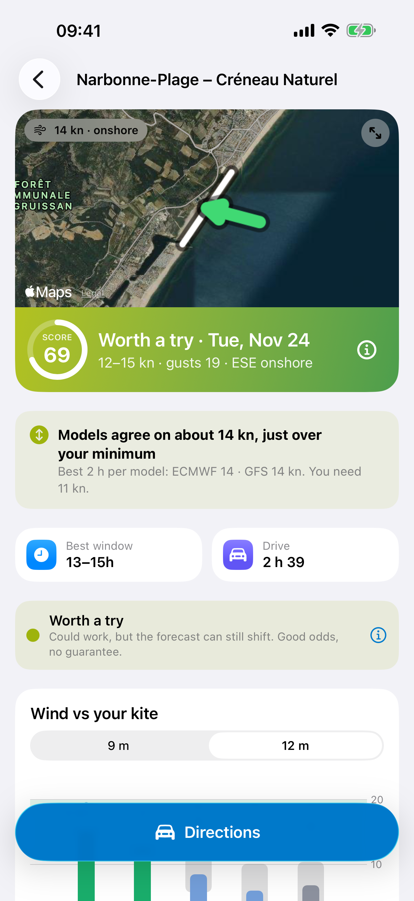 | 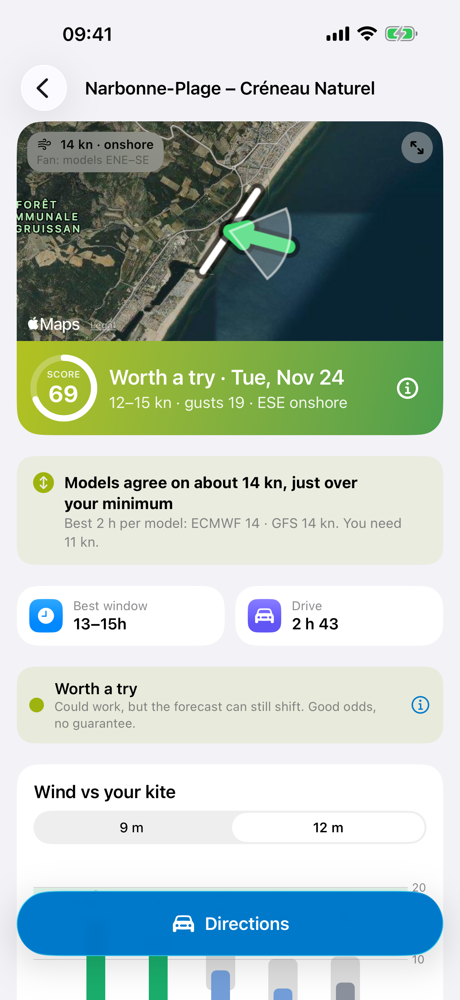 |
| Models split (El Trabucador, 25 Nov) | 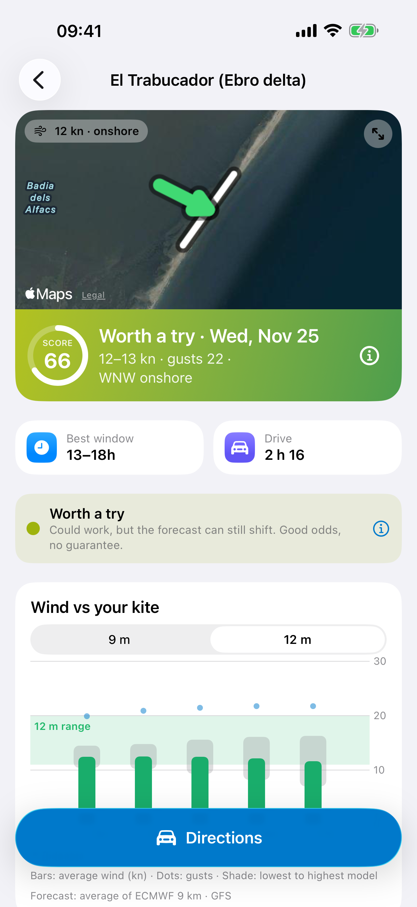 | 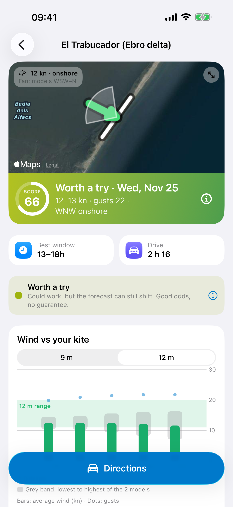 |

### Chart and hour by hour

| Case | Before | After |
|---|---|---|
| Go, models ENE–SE (Narbonne-Plage, 24 Nov) | 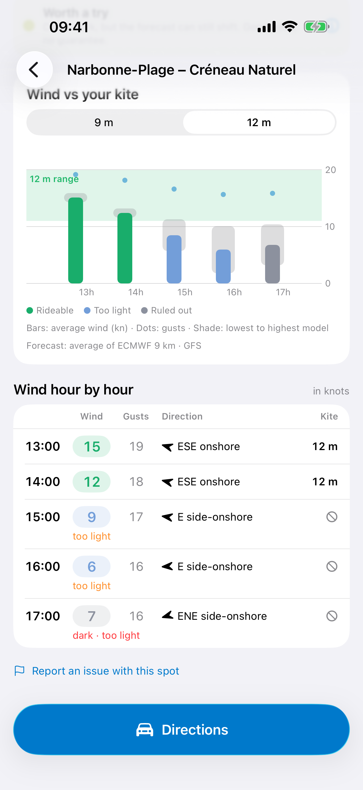 | 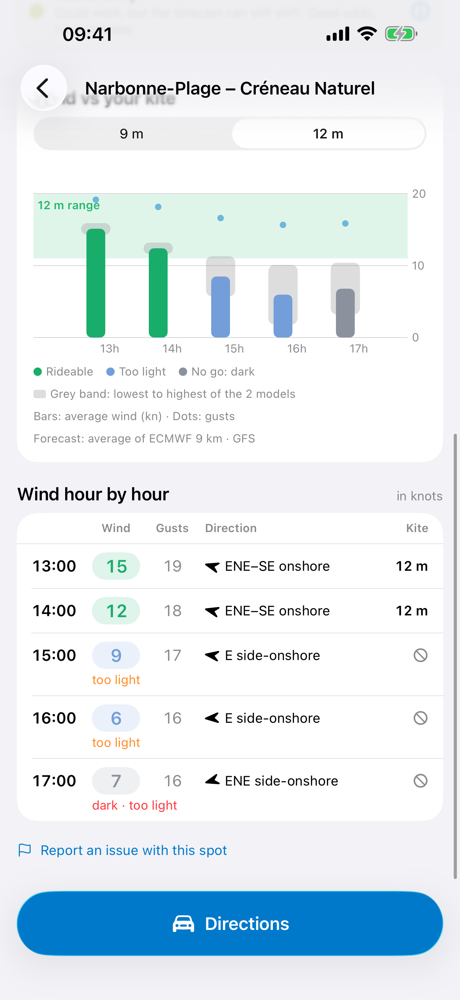 |
| Held back (Le Barcarès, 20 Nov) | 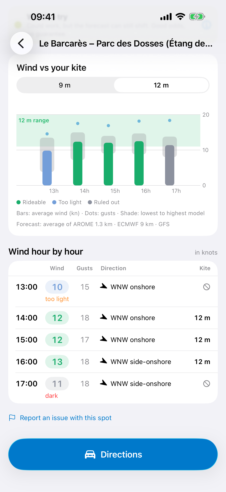 | 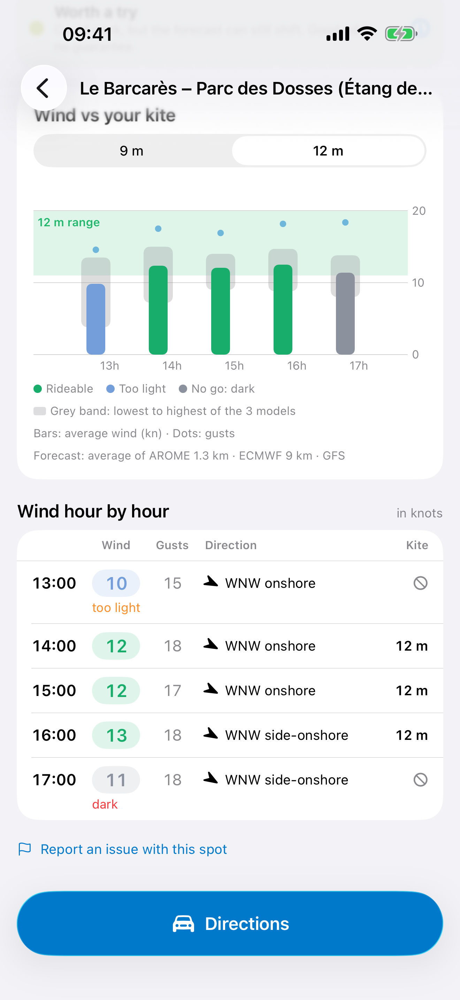 |
| Models split, worse direction scored (El Trabucador, 25 Nov) | 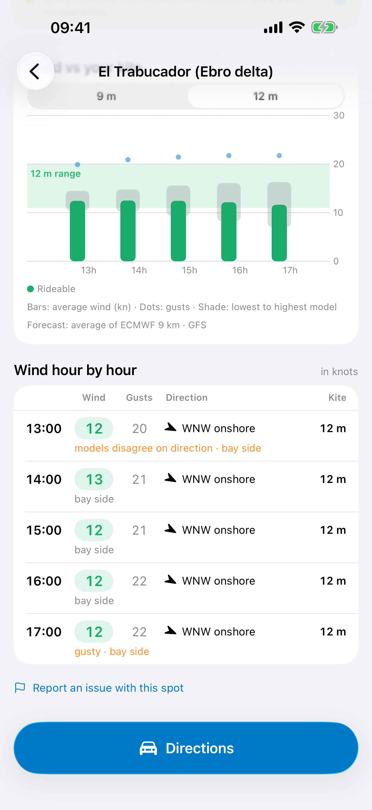 |  |

## What changed

1. **Grey band**: its own legend line under the chart, "Grey band: lowest to highest of the 3 models" (the real count). The caption no longer says "Shade".
2. **"Ruled out" → "No go: <why>"**, naming the reasons of the grey hours: storm, ban, too late, dark, unsure direction, offshore, tide. Plain "No go" if none applies. A long list moves to its own line.
3. **Direction range**, only when the models are 45° or more apart (two compass points), quiet otherwise:
   - **Hour by hour**: the hour shows their range, "ENE–SE" (the right way round north). Hours scored on the worse direction (WHE-231) say "models disagree on direction: the worse one counts".
   - **Spot map**: a light fan behind the arrow over every way the models blow during the best window, labelled under the wind chip ("Fan: models ENE–SE"). The full-screen map shows it hour by hour as you slide.

## What was tried, and what was kept

Both places, as you asked. **Kept: the map fan and the "ENE–SE" text in the hour list.** The map fan sits over the beach, so you see straight away whether the models' spread reaches offshore; it is quiet and labelled. **Dropped: a mini fan behind each hour's small arrow**: at that size it looks like a smudge and adds nothing the "ENE–SE" text doesn't say ([tried version](whe242-tried-arrowfan-go-chart.png), [split spot](whe242-tried-arrowfan-split-chart.png)).

## Wording

| EN | FR | ES |
|---|---|---|
| Grey band: lowest to highest of the 3 models | Bande grise : du plus bas au plus haut des 3 modèles | Banda gris: del más bajo al más alto de los 3 modelos |
| No go: storm, dark | No go : orage, nuit | No go: tormenta, noche |
| ban · too late · unsure direction · offshore · tide | interdit · trop tard · direction incertaine · offshore · marée | prohibido · demasiado tarde · dirección dudosa · offshore · marea |
| Fan: models ENE–SE | Éventail : modèles ENE–SE | Abanico: modelos ENE–SE |
| models disagree on direction: the worse one counts | les modèles divergent sur la direction : la pire compte | los modelos no coinciden en la dirección: cuenta la peor |
