# WHE-243: clearer model winds, in the hour list and on the map

## Round 2 (20 Nov): built, A3 and B4

You picked A3 for the hour list (A2 as the fallback) and B4 for the map, unless a field of arrows could be made tidy. Both are now built in the app, shown here on real forecasts.

### Field of arrows: tested, too messy

The only field that can show disagreement gives each model its own arrows, mixed across the water. When the models agree it looks great, but then it says nothing a single arrow doesn't. As soon as they disagree it turns into a checkerboard of arrows crossing each other (Leucate, Sète), which reads as turbulence rather than "two forecasts". So: B4.

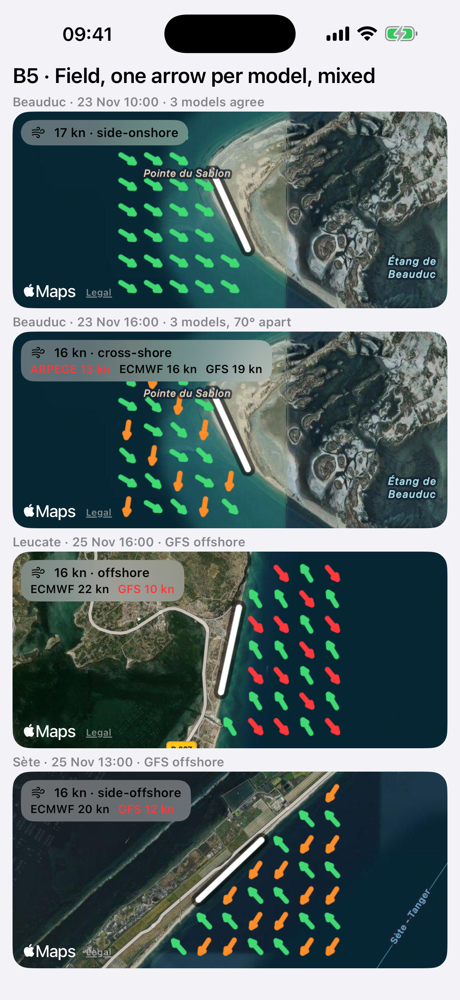

### Hour list: A3 built

One arrow per hour, the direction **the score used** (on a "worse one counts" hour, the worse model's, not the average), so the arrow, the words and the colour always agree. When the models are 45°+ apart, a small **≠** sits beside it: orange, or **red when one of them is offshore**. Tap the hour to open each model's arrow, name, speed and angle to the beach. A legend line under the list explains it. The full "≠ offshore?" label from the mock-up didn't fit next to "side-onshore" on a real phone, so it's just the symbol.

| Leucate 25 Nov, 13 h opened | Empuriabrava 22 Nov, 14 h opened (3 models, ARPEGE offshore) |
|---|---|
| 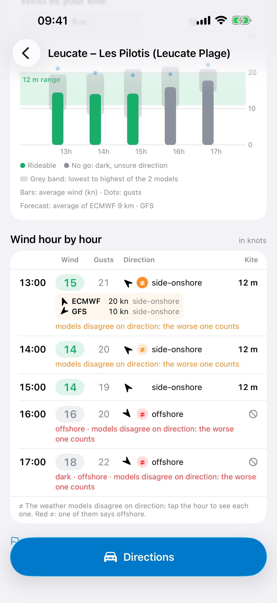 | 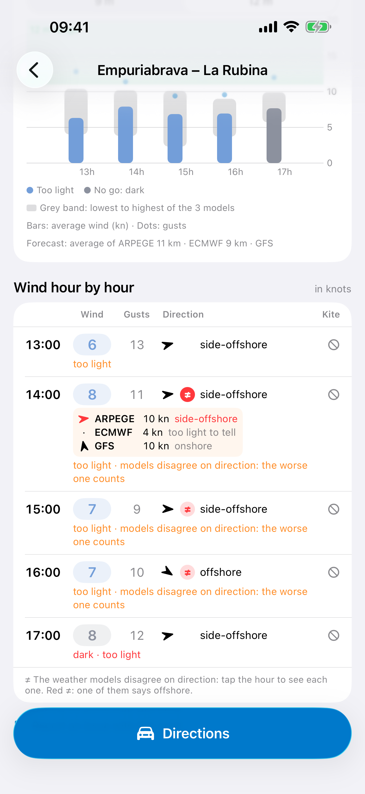 |

### Map: B4 built

When the models disagree, each gets its own arrow from the launch, coloured by its own angle, with "GFS 10" at the tail on the full-screen map. The fan is gone. The chip says "Models disagree: one arrow per model".

| Full map, Leucate 25 Nov 16 h | Full map, Empuriabrava 22 Nov 14 h | Spot page, Leucate 25 Nov |
|---|---|---|
| 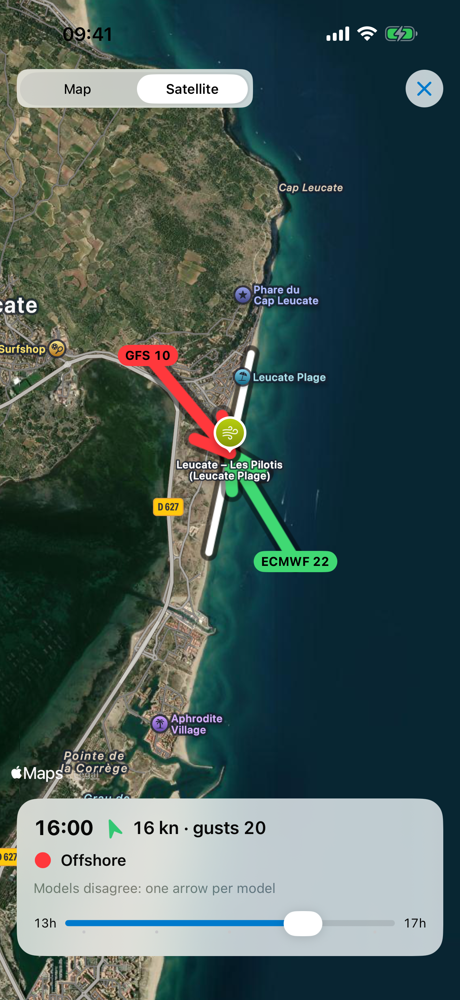 | 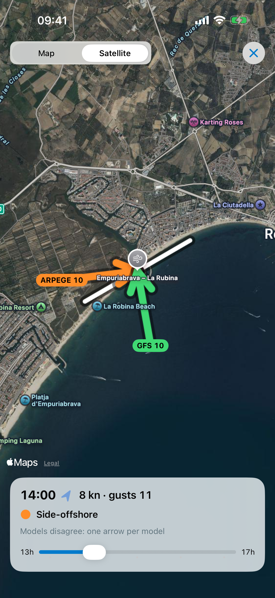 | 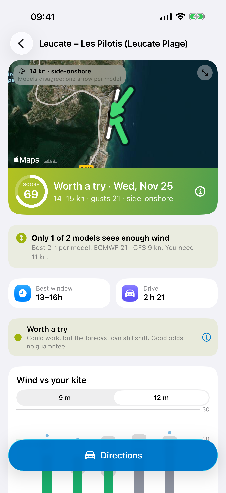 |

Known limits:
- The small map on the spot page has never shown the tail labels (same before this change), so there you get the colours but not the names. The full-screen map has them.
- The map colours by angle alone (orange from 100°, red from 130°), while the hour list's red follows your level's offshore rule. At Empuriabrava ARPEGE is orange on the map and red in the list.
- The safety question below is still open: between 45° and 90° apart, a red ≠ can sit on a rideable hour (one model offshore, the score doesn't count it).

## Round 1: options

Design study only: nothing is built in the app. Mock-ups are real simulator screens (iPhone 17 Pro Max) fed with real forecasts pulled on 20 Nov 2026 from the live Worker (`kite --hourly`), rider 75 kg, 9/12 m, intermediate.

| Case | Models | What it shows |
|---|---|---|
| Beauduc, Mon 23 Nov 12–16 h | ARPEGE, ECMWF, GFS | 3 models: agree at 12 h, then ARPEGE swings to N (45–70° apart) |
| Leucate – Les Pilotis, Wed 25 Nov 13–16 h | ECMWF, GFS | 2 models: GFS from NE at 13 h, from NW (**offshore**) at 16 h |
| Sète – Les 3 Digues, Wed 25 Nov 10–12 h | ECMWF, GFS | Offshore case: ECMWF onshore 20 kn, GFS NNE offshore 8–12 kn |

Mock-up code (throwaway, never merge): branch `atlas/t/whe-243-mockups`, launch with `-designStudy YES -designPage 1…8`.

## Two things the study turned up first

1. **The two thresholds don't match.** The hour list splits into one arrow per model from **45°** apart, but the scoring only uses "the worse one counts" from **90°**. Between the two, a rider sees a **red arrow on a rideable hour** with no explanation. Real case: Beauduc 14–16 h, ARPEGE from N at 11 kn is offshore, yet the hour says "side-onshore · 12 m" (see A1 and A2). That, more than the arrows themselves, is probably why they feel unclear.
2. **The map arrow can contradict itself.** Today the big arrow points the *average* direction but takes its colour from the *worse* model. Leucate 16 h: ECMWF SSE, GFS NW, so the average is ~SSE, almost along the beach, yet the arrow is red "offshore" (see B1). Any option built on the average direction (B1, B2, B3) has this problem.

## A. Hour by hour

| | Mock-up |
|---|---|
| **A1** Today's arrows + a one-line legend | 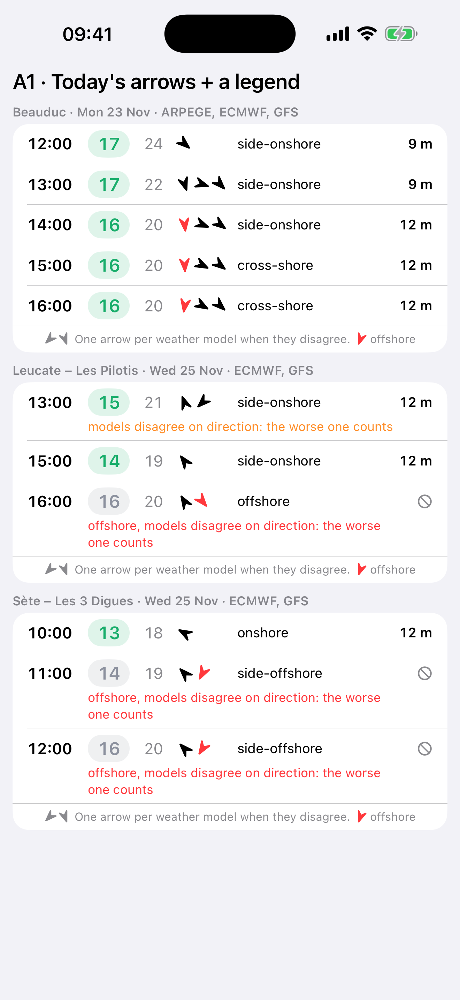 |
| **A2** Each arrow labelled with the model's initial + legend | 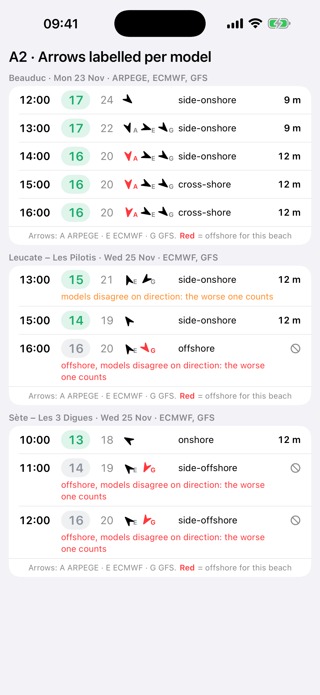 |
| **A3** One arrow + a "≠" badge; tap opens each model's wind | 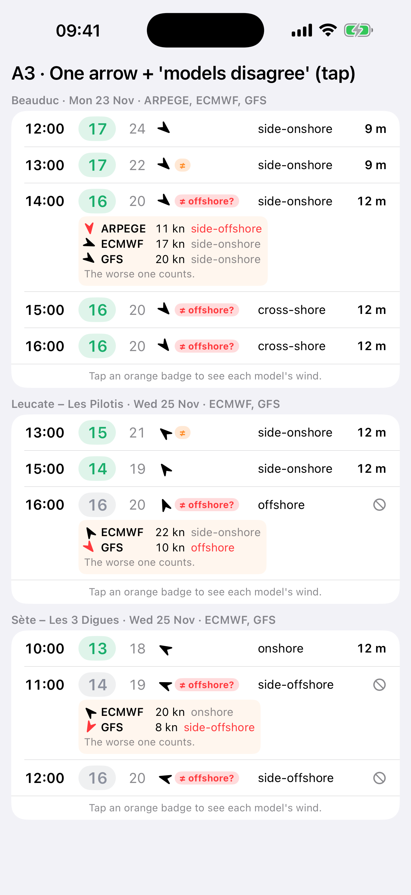 |
| **A4** Compass disc with a wedge over the spread, red where offshore | 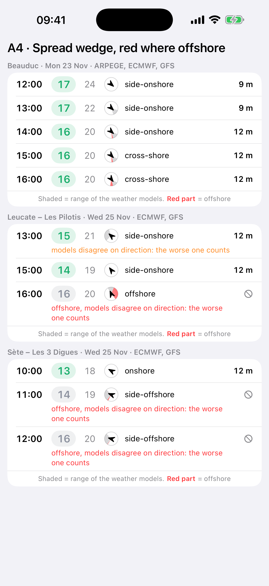 |

**A1 · Legend**
- \+ Smallest change; the legend answers "why three arrows?".
- − Still doesn't say which arrow is which model, or how strong each blows.
- − A legend line per card is easy to skip; the red arrow beside "side-onshore" stays puzzling.

**A2 · Initials**
- \+ You can tell GFS from ECMWF and learn which model runs offshore.
- − The 9 pt letters are tiny; three arrows + letters fill the column.
- − Colours per model were ruled out: red is taken by "offshore".

**A3 · One arrow + badge, tap to expand**
- \+ Calm by default: one arrow per hour like any wind app; the badge only appears when it matters.
- \+ A red "≠ offshore?" badge says the important part without decoding arrows.
- \+ The expanded panel has room for what riders actually want: model, speed, angle to the beach.
- − Needs a tap to see the detail; the single arrow must be the direction the score used, not the average (else Leucate 16 h shows a SSE arrow next to "offshore").

**A4 · Wedge**
- \+ Very compact, one glyph per hour; red slice reads as "danger in the spread".
- − At 24 pt the red slice is a sliver (Sète 11–12 h): you have to know to look for it.
- − Hides how many models and which one; the wedge between two models suggests winds nobody forecast.

## B. Spot map

| | Mock-up |
|---|---|
| **B1** Today: one big arrow + light fan | 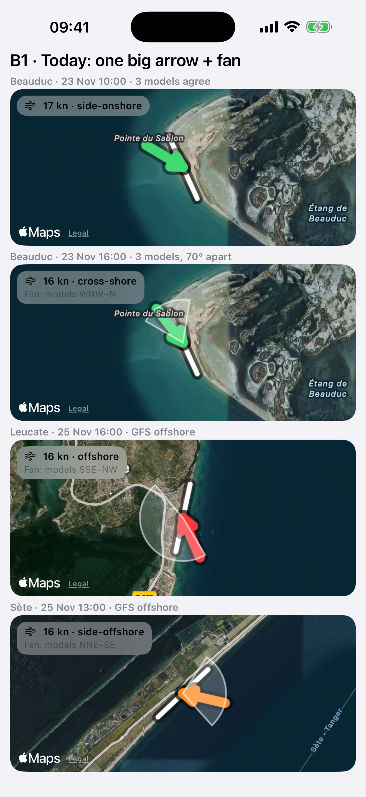 |
| **B2** Field of small arrows over the water | 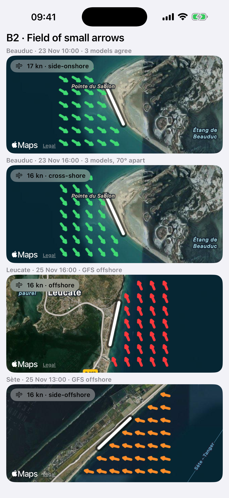 |
| **B3** Field in the average direction + "models disagree" badge | 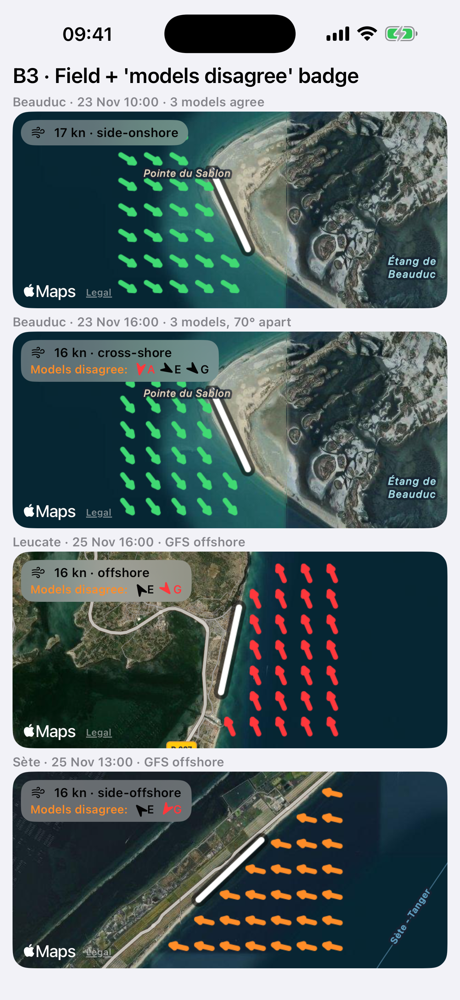 |
| **B4** One arrow per model, each coloured by its own angle | 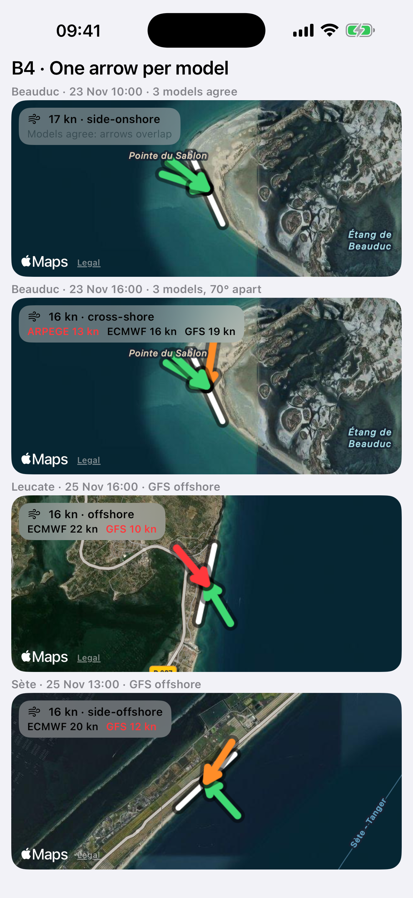 |

(The speed label at the arrow's tail is missing in these mock-ups; the real overlay keeps it.)

### Does a field of arrows add information? No.

- **One forecast point per spot.** Every small arrow shows the same value; the field just repeats one number 30 times (see B2: identical arrows).
- **More points wouldn't change it.** The models' grids are 9 km (ECMWF), 11 km (ARPEGE) and 13–25 km (GFS); the spot map shows 4 km. A whole map sits inside one grid cell, so extra points would mostly return the same wind. Only AROME (1.3 km, France, first 2 days) could vary across the map, and even then it doesn't model the coastal effects riders care about at that scale.
- **The cost is real.** About 12 points per spot means 12× the forecast locations: Open-Meteo counts each location against the free quota (10,000 calls a day, WHE-12), and the Worker already batches ~100 spots under the 50-subrequest limit, which 12× would break.
- **It reads as more certain than it is.** A dense, uniform field looks like a measured flow, which is the opposite of a 5-days-ahead disagreement. And B2 at Leucate shows a sea of red arrows blowing *along* the beach.

**B1 · Today (arrow + fan)**
- \+ Clean, already shipped, labelled.
- − The fan says "somewhere in here" but not which model, and the arrow colour can contradict its direction (Leucate).

**B2 · Field**
- \+ Looks like a pro weather map.
- − No new information, all the cost above, and it has no way to show disagreement.

**B3 · Field + badge**
- \+ The badge names the models and marks the offshore one.
- − Still the B2 field, and the field contradicts the badge (red field pointing along the beach, badge says GFS from NW).

**B4 · One arrow per model**
- \+ Each arrow is a real forecast, coloured by its own angle: the offshore one visibly comes **from the land** (Leucate, Sète). Nothing to decode.
- \+ When the models agree, the arrows overlap into one (Beauduc 10 h): no clutter on normal days.
- − With 3 models apart, the tails overlap near the launch; needs the speed label per arrow and a short legend in the chip.

## Recommendation

- **Hour list: A3 (recommended)**: one arrow per hour, plus a "≠" badge (red "≠ offshore?" when a model is offshore) that expands to each model's direction, speed and angle. The single arrow shows the direction the score used, so arrow, words and colour always agree. Runner-up: A2.
- **Map: B4 (recommended)**: one arrow per model when they disagree, one arrow when they agree; drop the fan. No vector field: it adds cost and no information.
- **Plus one safety call for you, separate card**: line up the 45° / 90° gap. Options: 1) "the worse one counts" whenever any model is offshore, whatever the spread (recommended, safety first; goes to review with a before/after); 2) keep 90° and show models only from 90°, so no red arrow ever sits on a rideable hour.
